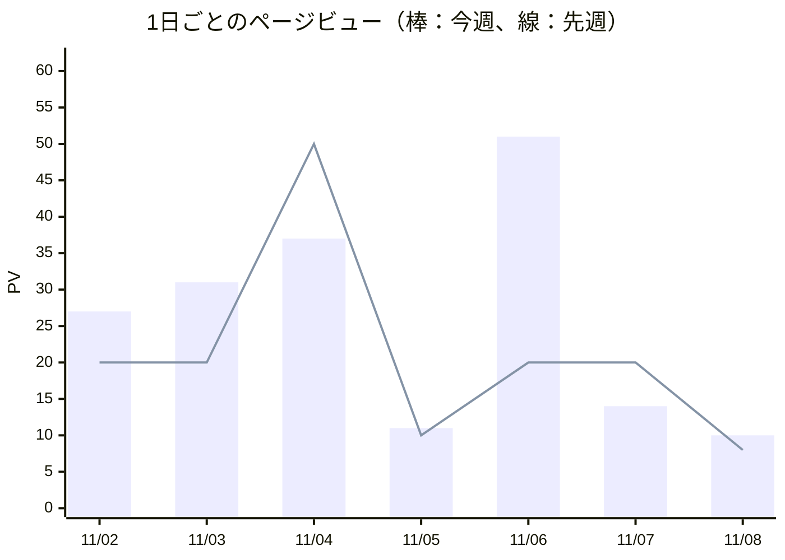

# 週次レポート 2026-11-02 〜 2026-11-08

## 数字のまとめ

|  | 今週 | 先週 | 増減 |
|:---|---:|---:|---:|
| ページビュー | 181 | 148 | ↑ +22.3% |
| 訪問数 | 86 | 68 | ↑ +26.5% |
| 公開した記事 | 7 | - | - |

## 日別のアクセス

| 日 | PV | 訪問 | 先週の同じ曜日のPV | グラフ |
|:---|---:|---:|---:|:---|
| 11/02 | 27 | 14 | 20 | ██████ |
| 11/03 | 31 | 13 | 20 | ███████ |
| 11/04 | 37 | 13 | 50 | █████████ |
| 11/05 | 11 | 6 | 10 | ███ |
| 11/06 | 51 | 21 | 20 | ████████████ |
| 11/07 | 14 | 9 | 20 | ███ |
| 11/08 | 10 | 10 | 8 | ██ |



※1日の数字は少ないとぶれやすいので、判断は週の合計で行います。

## よく読まれたページ トップ10

| 順位 | ページ | PV |
|---:|:---|---:|
| 1 | `/` | 54 |
| 2 | `/matome/` | 9 |
| 3 | `/sheets/tani-wariai` | 9 |
| 4 | `/sheets/zukei` | 8 |
| 5 | `/sheets/kenpo-sanken` | 8 |
| 6 | `/sheets/nenpyo` | 7 |
| 7 | `/sheets/kankyo-kagaku` | 7 |
| 8 | `/news/2026-11-02` | 6 |
| 9 | `/news/2026-11-04` | 6 |
| 10 | `/news/2026-11-05` | 6 |

## どこから来たか

| 流入元 | PV | 割合 |
|:---|---:|---:|
| （サイト内） | 95 | 52% |
| （直接・不明） | 46 | 25% |
| m.facebook.com | 15 | 8% |
| www.google.com | 7 | 4% |
| www.facebook.com | 7 | 4% |
| search.yahoo.co.jp | 6 | 3% |
| l.instagram.com | 3 | 2% |
| dataindex.pro | 1 | 1% |

| 端末 | PV | 割合 |
|:---|---:|---:|
| desktop | 143 | 79% |
| mobile | 38 | 21% |

## SNS

| SNS | フォロワー等 | 今週の投稿 | 今週の表示 | 先週の表示 | 増減 |
|:---|---:|---:|---:|---:|---:|
| X | 0 | 7 | 7 | 25 | -72% |
| Threads | 1 | 7 | 64 | 106 | -39.6% |
| Instagram | 13 | 10 | 1,320 | 771 | +71.2% |
| YouTube | 1 | 15 | 3 | 25 | -88% |
| LINE（友だち） | 1 | - | - | - | 1週間で 1人 |

Instagram：1本あたり（今週）

| 種類 | 本数 | 表示/本 | いいね/本 | コメント/本 | 保存/本 |
|:---|---:|---:|---:|---:|---:|
| 朝のまとめ | 7 | 129 | 0.9 | 0.1 | 0.3 |
| 夕方のクイズ | 3 | 138 | 0.0 | 0.0 | 0.0 |

## フォロワー・登録者の推移（毎日の記録）

| 日 | x | threads | instagram | line |
|:---|---:|---:|---:|---:|
| 11/06 | 0 | 1 | 8 | 1 |
| 11/07 | 0 | 1 | 10 | 1 |
| 11/08 | 0 | 1 | 12 | 1 |

```mermaid
xychart-beta
  title "threads フォロワー等の推移"
  x-axis ["11/06", "11/07", "11/08"]
  y-axis "人" 0 --> 5
  line [1, 1, 1]
```

```mermaid
xychart-beta
  title "instagram フォロワー等の推移"
  x-axis ["11/06", "11/07", "11/08"]
  y-axis "人" 0 --> 15
  line [8, 10, 12]
```

```mermaid
xychart-beta
  title "line フォロワー等の推移"
  x-axis ["11/06", "11/07", "11/08"]
  y-axis "人" 0 --> 5
  line [1, 1, 1]
```

## X の投稿と費用の目安

| 項目 | 値 |
|:---|---:|
| 今週の投稿回数 | 7 |
| 今週のおおよその費用 | $1.51 |
| クレジット残りの見込み | $7.21（あと約33日） |

※実際の残高は developer.x.com の Developer Console で確認してください。

