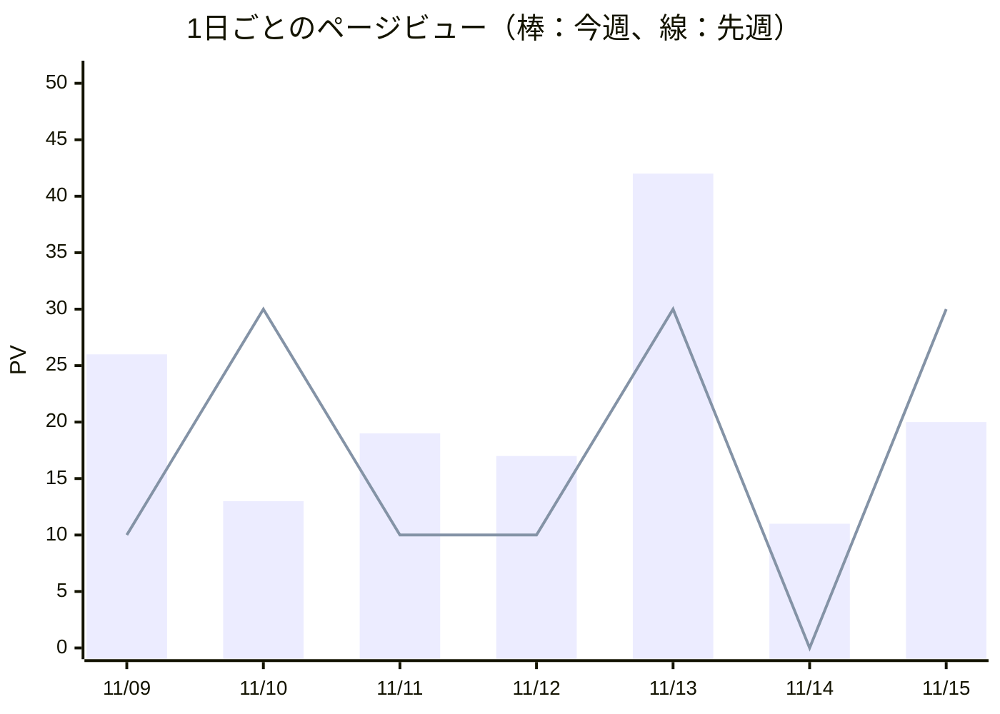
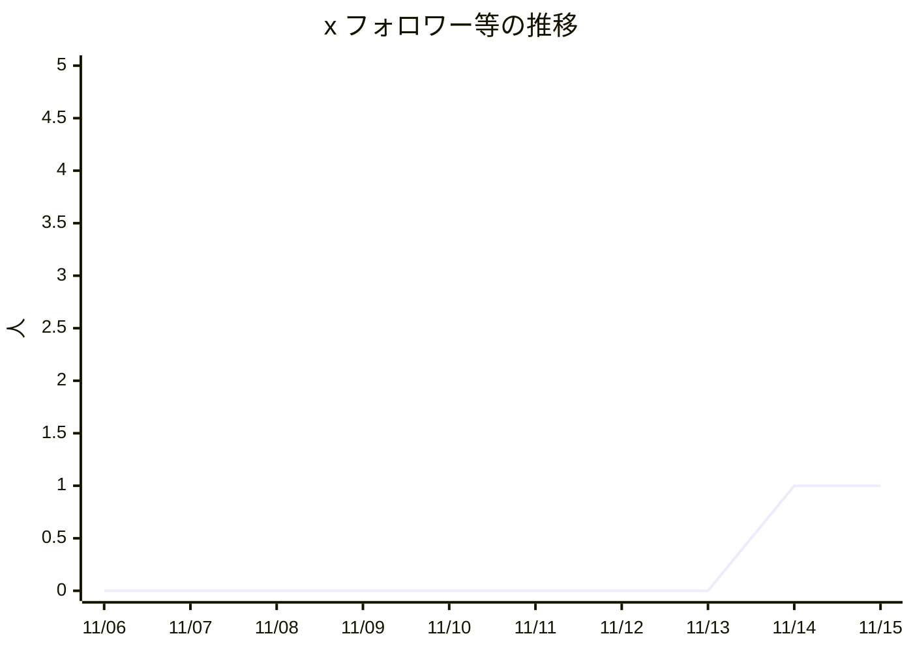
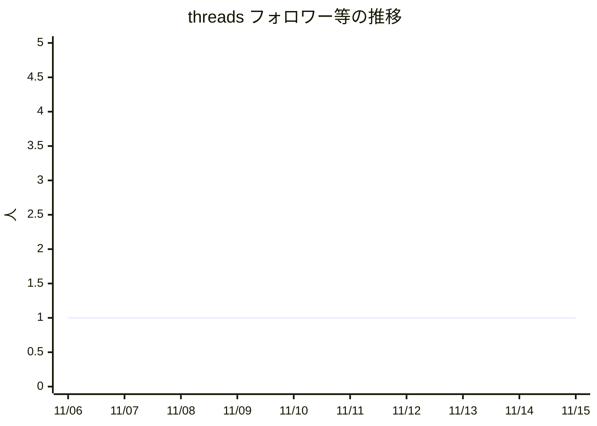
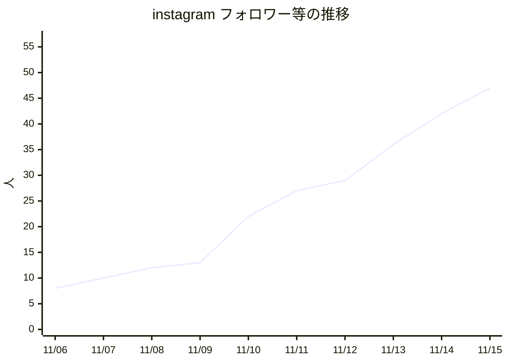
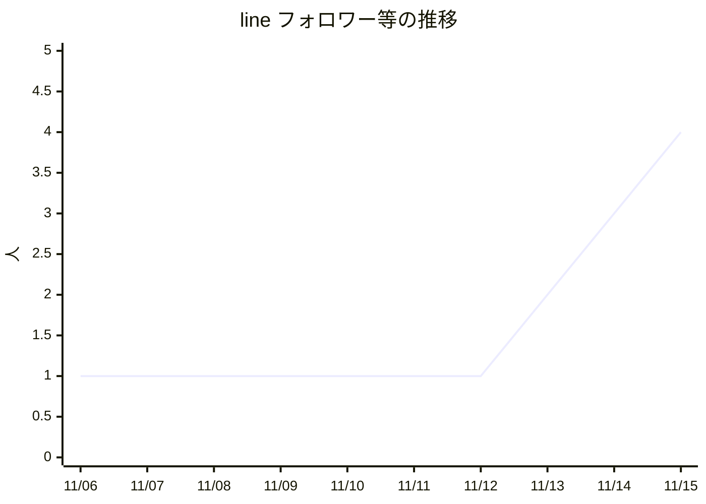

# 週次レポート 2026-11-09 〜 2026-11-15

## 数字のまとめ

|  | 今週 | 先週 | 増減 |
|:---|---:|---:|---:|
| ページビュー | 148 | 120 | ↑ +23.3% |
| 訪問数 | 79 | 80 | ↓ -1.2% |
| 日本からのPV（人に近い数字） | 116 | 70 | ↑ +65.7% |
| 公開した記事 | 7 | - | - |

## 日別のアクセス

| 日 | PV | 訪問 | 先週の同じ曜日のPV | グラフ |
|:---|---:|---:|---:|:---|
| 11/09 | 26 | 9 | 10 | ███████ |
| 11/10 | 13 | 3 | 30 | ████ |
| 11/11 | 19 | 13 | 10 | █████ |
| 11/12 | 17 | 11 | 10 | █████ |
| 11/13 | 42 | 16 | 30 | ████████████ |
| 11/14 | 11 | 11 | 0 | ███ |
| 11/15 | 20 | 16 | 30 | ██████ |

※1日の数字は少ないとぶれやすいので、判断は週の合計で行います。

## よく読まれたページ トップ10

| 順位 | ページ | PV |
|---:|:---|---:|
| 1 | `/` | 26 |
| 2 | `/sheets/` | 24 |
| 3 | `/weekly/2026-11-09` | 11 |
| 4 | `/news/2026-11-11` | 7 |
| 5 | `/matome/2027-ranking` | 6 |
| 6 | `/news/2026-11-14` | 6 |
| 7 | `/sheets/zukei` | 5 |
| 8 | `/sheets/kotowaza` | 5 |
| 9 | `/news/2026-11-12` | 5 |
| 10 | `/news/2026-11-13` | 4 |

LINEボタン（「LINEで受け取る」）を押された数

| 押されたページ | 回数 |
|---:|:---|
| `sheets` | 2 |

国別のPV（日本以外が多いときは、ボットが混ざっている可能性があります）

| 国 | PV | 割合 |
|:---|---:|---:|
| JP | 116 | 78% |
| US | 23 | 16% |
| SE | 7 | 5% |
| IE | 2 | 1% |

## どこから来たか

| 流入元 | PV | 割合 |
|:---|---:|---:|
| （サイト内） | 69 | 47% |
| （直接・不明） | 57 | 39% |
| www.facebook.com | 14 | 9% |
| m.facebook.com | 3 | 2% |
| www.google.com | 2 | 1% |
| l.instagram.com | 2 | 1% |
| search.yahoo.co.jp | 1 | 1% |

| 端末 | PV | 割合 |
|:---|---:|---:|
| desktop | 102 | 69% |
| mobile | 40 | 27% |
| tablet | 6 | 4% |

## SNS

| SNS | フォロワー等 | 今週の投稿 | 今週の表示 | 先週の表示 | 増減 |
|:---|---:|---:|---:|---:|---:|
| X | 1 | 7 | 2 | 7 | -71.4% |
| Threads | 1 | 7 | 71 | 65 | +9.2% |
| Instagram | 51 | 7 | 1,085 | 1,358 | -20.1% |
| YouTube | 1 | 14 | 1 | 5 | -80% |
| LINE（友だち） | 4 | - | - | - | 1週間で 3人 |

Instagram：1本あたり（今週）

| 種類 | 本数 | 表示/本 | いいね/本 | コメント/本 | 保存/本 |
|:---|---:|---:|---:|---:|---:|
| 朝のまとめ | 7 | 155 | 0.7 | 0.0 | 0.0 |
| 夕方のクイズ | 0 | 0 | 0.0 | 0.0 | 0.0 |

## フォロワー・登録者の推移（毎日の記録）

| 日 | x | threads | instagram | line |
|:---|---:|---:|---:|---:|
| 11/09 | 0 | 1 | 13 | 1 |
| 11/10 | 0 | 1 | 22 | 1 |
| 11/11 | 0 | 1 | 27 | 1 |
| 11/12 | 0 | 1 | 29 | 1 |
| 11/13 | 0 | 1 | 36 | 2 |
| 11/14 | 1 | 1 | 42 | 3 |
| 11/15 | 1 | 1 | 47 | 4 |

## X の投稿と費用の目安

| 項目 | 値 |
|:---|---:|
| 今週の投稿回数 | 7 |
| 今週のおおよその費用 | $1.51 |
| クレジット残りの見込み | $5.49（あと約25日） |

※実際の残高は developer.x.com の Developer Console で確認してください。

