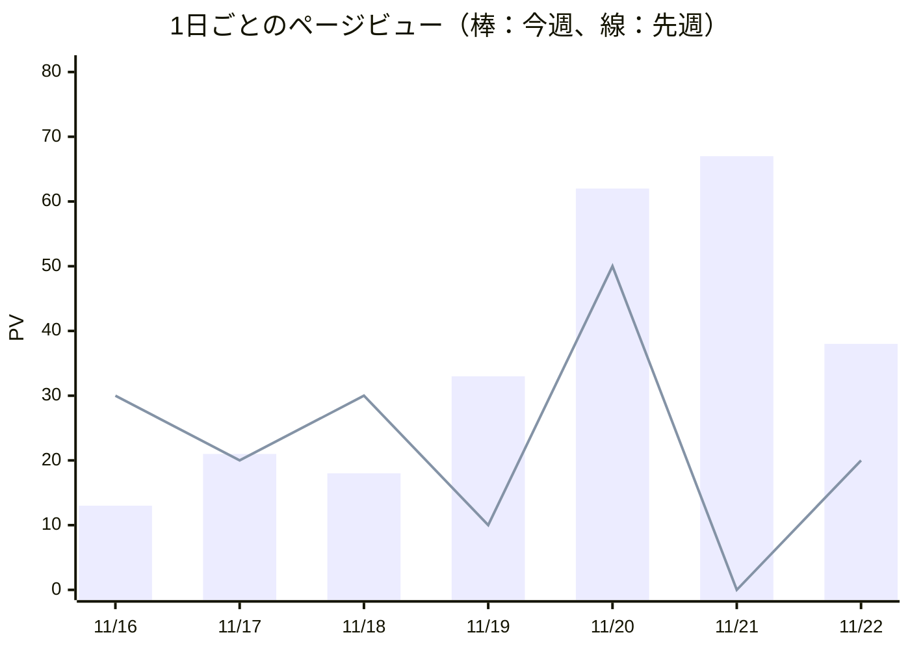
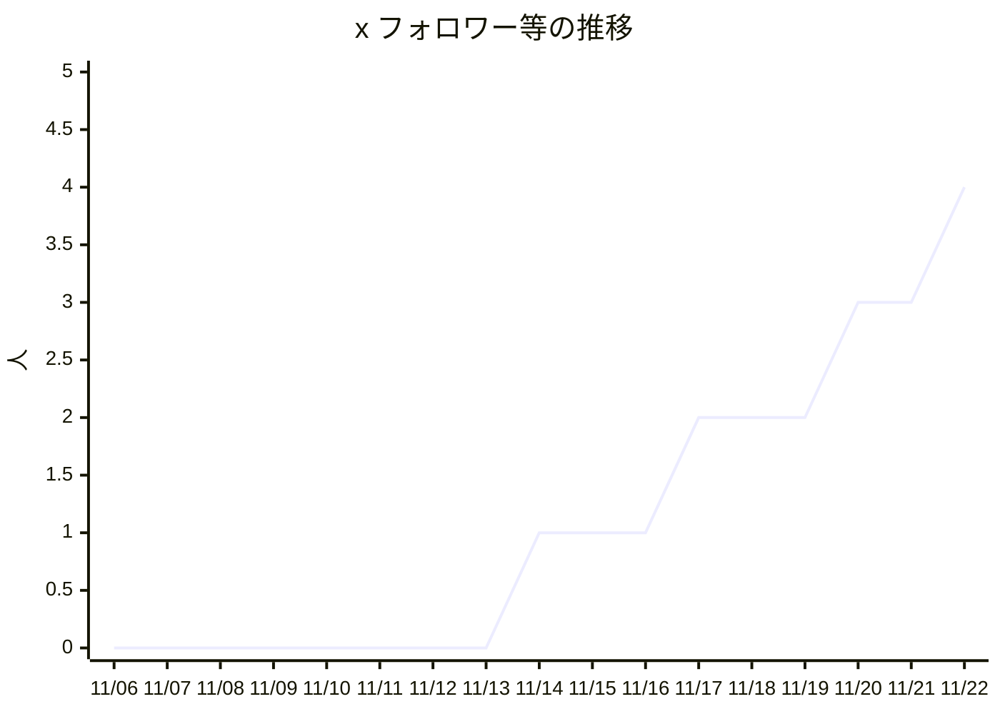
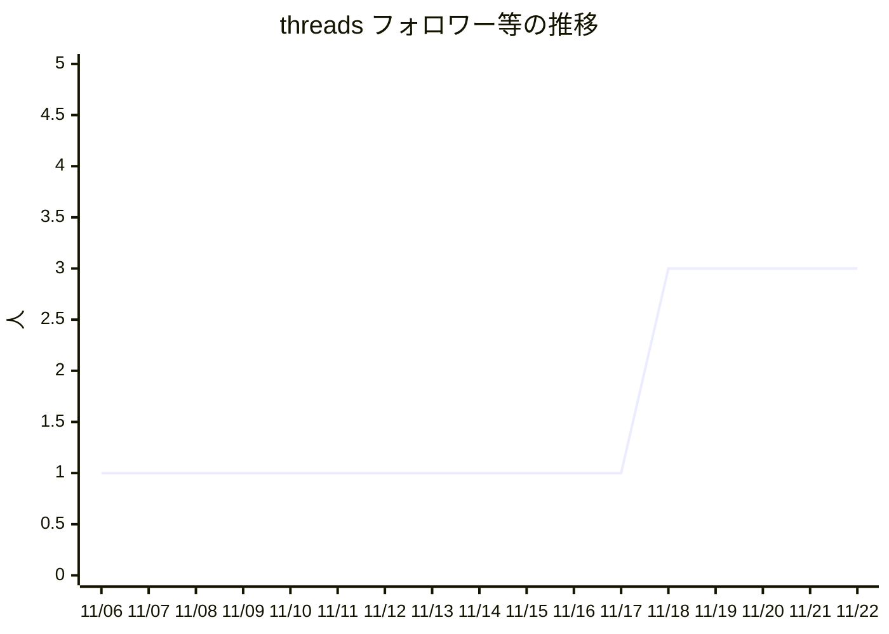
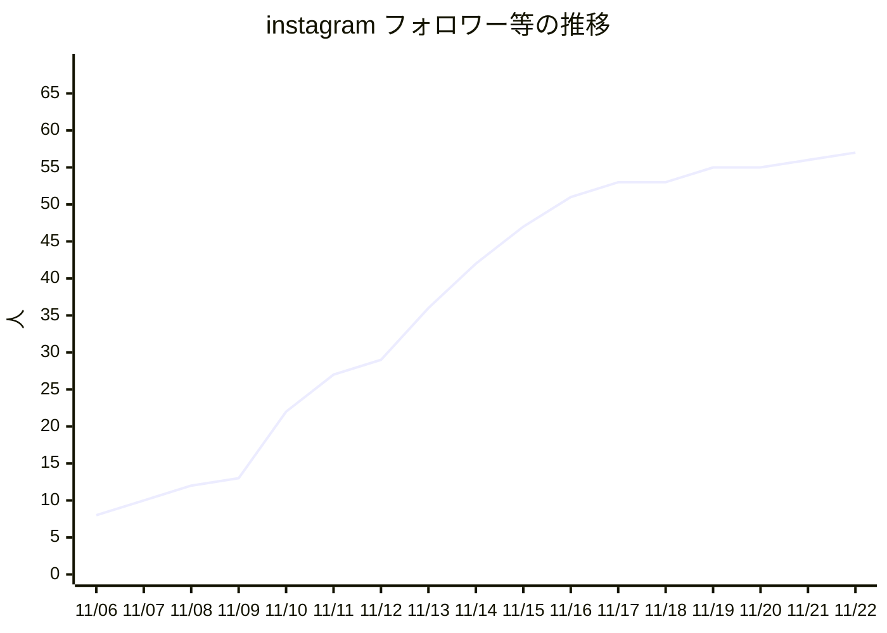
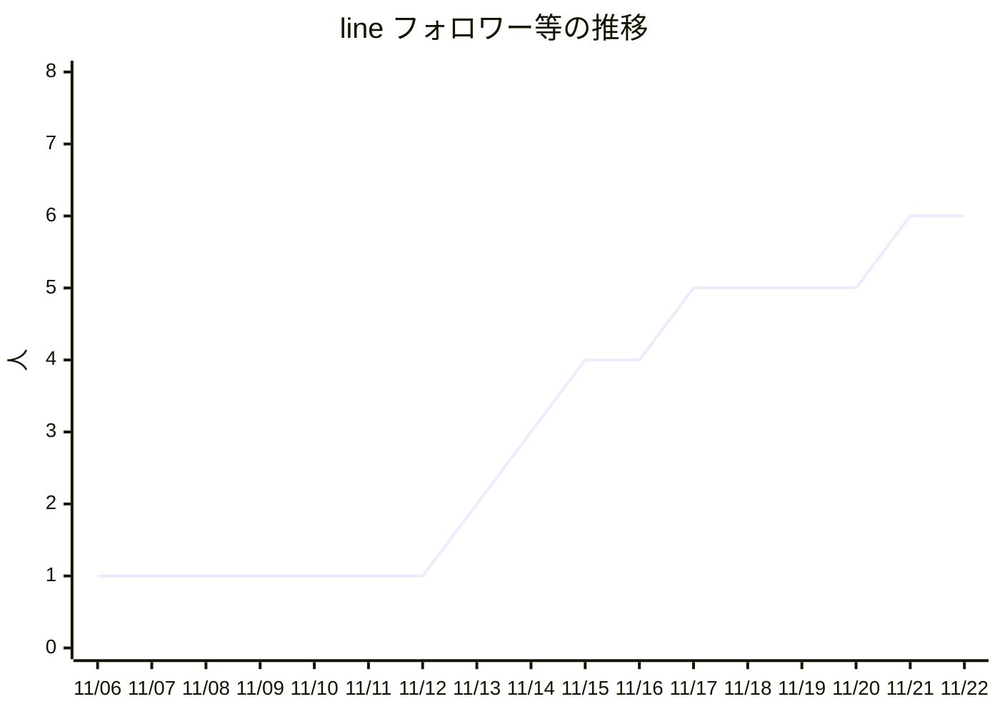

# 週次レポート 2026-11-16 〜 2026-11-22

## 数字のまとめ

|  | 今週 | 先週 | 増減 |
|:---|---:|---:|---:|
| ページビュー | 252 | 160 | ↑ +57.5% |
| 訪問数 | 114 | 50 | ↑ +128% |
| 日本からのPV（人に近い数字） | 210 | 150 | ↑ +40% |
| 公開した記事 | 7 | - | - |

## 日別のアクセス

| 日 | PV | 訪問 | 先週の同じ曜日のPV | グラフ |
|:---|---:|---:|---:|:---|
| 11/16 | 13 | 11 | 30 | ██ |
| 11/17 | 21 | 20 | 20 | ████ |
| 11/18 | 18 | 18 | 30 | ███ |
| 11/19 | 33 | 22 | 10 | ██████ |
| 11/20 | 62 | 16 | 50 | ███████████ |
| 11/21 | 67 | 12 | 0 | ████████████ |
| 11/22 | 38 | 15 | 20 | ███████ |

※1日の数字は少ないとぶれやすいので、判断は週の合計で行います。

## よく読まれたページ トップ10

| 順位 | ページ | PV |
|---:|:---|---:|
| 1 | `/sheets/` | 21 |
| 2 | `/` | 18 |
| 3 | `/weekly/2026-11-09` | 16 |
| 4 | `/matome/` | 15 |
| 5 | `/matome/2027-ranking` | 13 |
| 6 | `/news/2026-11-20` | 12 |
| 7 | `/matome/2027` | 9 |
| 8 | `/news/2026-11-21` | 9 |
| 9 | `/sheets/nenpyo-goro` | 9 |
| 10 | `/news/2026-11-17` | 8 |

LINEボタン（「LINEで受け取る」）を押された数

| 押されたページ | 回数 |
|---:|:---|
| `side` | 1 |
| `sheet-nenpyo-goro` | 1 |

国別のPV（日本以外が多いときは、ボットが混ざっている可能性があります）

| 国 | PV | 割合 |
|:---|---:|---:|
| JP | 210 | 83% |
| US | 29 | 12% |
| CN | 6 | 2% |
| IE | 4 | 2% |
| SE | 2 | 1% |
| DE | 1 | 0% |

## どこから来たか

| 流入元 | PV | 割合 |
|:---|---:|---:|
| （サイト内） | 138 | 55% |
| （直接・不明） | 76 | 30% |
| m.facebook.com | 12 | 5% |
| www.facebook.com | 10 | 4% |
| search.yahoo.co.jp | 9 | 4% |
| t.co | 5 | 2% |
| l.threads.com | 2 | 1% |

| 端末 | PV | 割合 |
|:---|---:|---:|
| mobile | 137 | 54% |
| desktop | 115 | 46% |

## SNS

| SNS | フォロワー等 | 今週の投稿 | 今週の表示 | 先週の表示 | 増減 |
|:---|---:|---:|---:|---:|---:|
| X | 5 | 7 | 143 | 12 | +1091.7% |
| Threads | 3 | 7 | 249 | 73 | +241.1% |
| Instagram | 58 | 7 | 851 | 1,087 | -21.7% |
| YouTube | 1 | 14 | 0 | 4 | -100% |
| LINE（友だち） | 6 | - | - | - | 1週間で 2人 |

Instagram：1本あたり（今週）

| 種類 | 本数 | 表示/本 | いいね/本 | コメント/本 | 保存/本 |
|:---|---:|---:|---:|---:|---:|
| 朝のまとめ | 7 | 122 | 0.7 | 0.0 | 0.0 |
| 夕方のクイズ | 0 | 0 | 0.0 | 0.0 | 0.0 |

## フォロワー・登録者の推移（毎日の記録）

| 日 | x | threads | instagram | line |
|:---|---:|---:|---:|---:|
| 11/16 | 1 | 1 | 51 | 4 |
| 11/17 | 2 | 1 | 53 | 5 |
| 11/18 | 2 | 3 | 53 | 5 |
| 11/19 | 2 | 3 | 55 | 5 |
| 11/20 | 3 | 3 | 55 | 5 |
| 11/21 | 3 | 3 | 56 | 6 |
| 11/22 | 4 | 3 | 57 | 6 |

## X の投稿と費用の目安

| 項目 | 値 |
|:---|---:|
| 今週の投稿回数 | 7 |
| 今週のおおよその費用 | $1.51 |
| クレジット残りの見込み | $3.98（あと約18日） |

※実際の残高は developer.x.com の Developer Console で確認してください。

